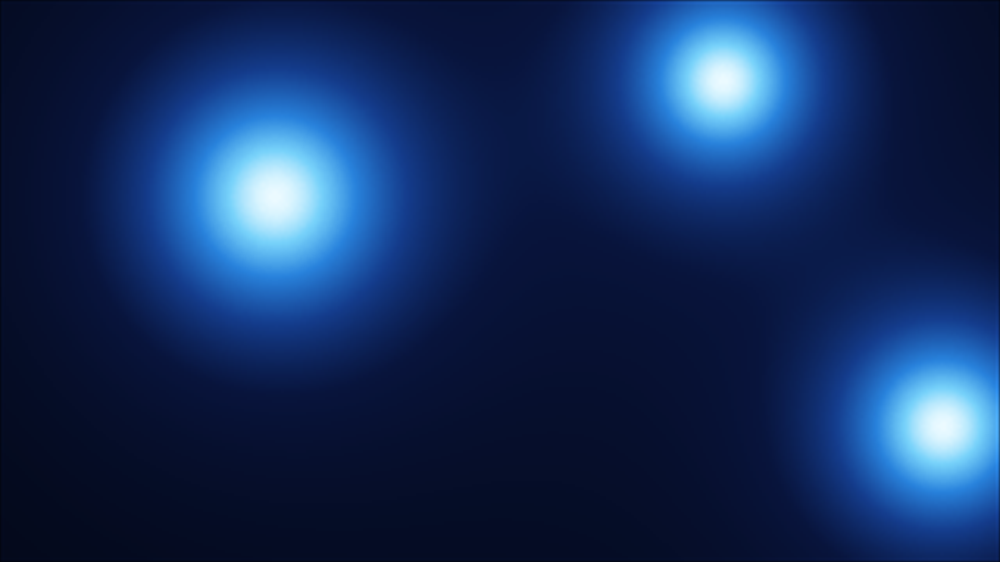

# Metaballs ScreenSaver
A Metaballs Windows ScreenSaver

## 👤 Authors

* [@remusrigo](https://github.com/RemusRigo)
* [@remusrigo](https://sourceforge.net/u/remusrigo/profile)

## ✨ Features

* Metaballs effect: glowing blobs that drift, merge and split like wax in a lava lamp
* Blue or red color palette
* 2 or 3 blobs, adjustable speed, blob radius and glow intensity
* Multi-monitor support
* Preview inside the Windows screensaver picker
* Settings stored in Registry

## 🛠️ User's Guide

See the [User's Guide](Users%20Guide.md) for downloads, runtimes, installation and settings.

## ⚙️ Statistics

 

## 🗺️ Roadmap

* 2026-11-09: Add: About form
* 2026-11-08: Fix: Settings form OK/Cancel buttons now close the dialog; settings are saved on OK only, Cancel discards changes
* 2026-11-08: Upd: Changed logic in Settings form (frmCfg)
* 2026-11-07: Upd: Changed logic in AppSettings
* 2026-08-14: Project started
